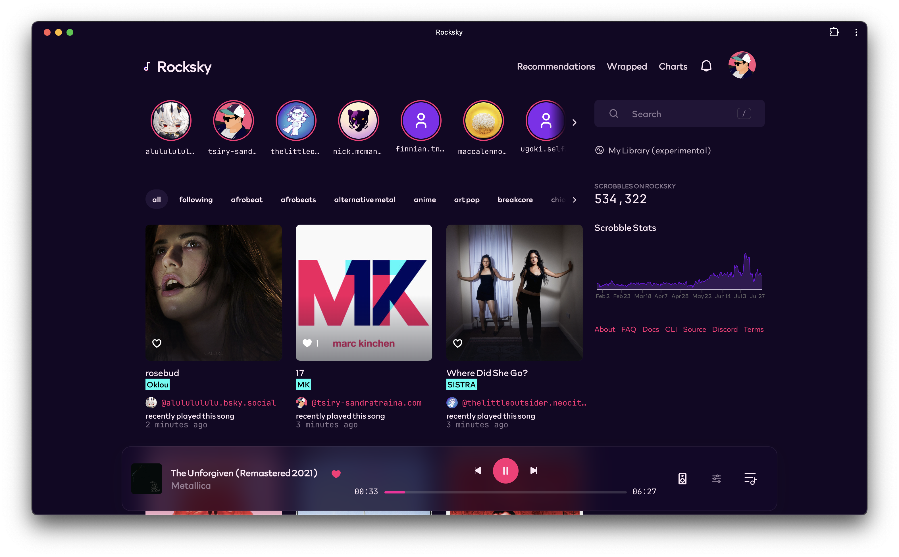

# Rocksky 

[](https://github.com/tsirysndr/rocksky/actions/workflows/ci.yml)
[](https://github.com/tsirysndr/rocksky/actions/workflows/build.yml)
[](https://discord.gg/EVcBy2fVa3)
[](https://flakehub.com/flake/tsirysndr/rocksky)

**A decentralized, open-source Last.fm alternative built on the AT Protocol (Bluesky).**

Rocksky automatically tracks ("scrobbles") the music you listen to from Spotify, Jellyfin, Navidrome, browsers, Android, and more — then publishes it to your decentralized identity. Own your listening history, see what friends are playing in real time, get rich stats, and discover new music — all without a central company controlling your data.

**[rocksky.app](https://rocksky.app)** • **[Docs](https://docs.rocksky.app)** • **[Discord](https://discord.gg/EVcBy2fVa3)**

<a href="https://play.google.com/store/apps/details?id=app.rocksky">
  
</a>



## Contents

- [Features](#-features)
  - [Scrobbling](#-scrobbling)
  - [Your library](#-your-library)
  - [Playback](#-playback)
  - [Physical shortcuts](#-physical-shortcuts)
  - [Social & discovery](#-social--discovery)
  - [Insights](#-insights)
  - [Apps & clients](#-apps--clients)
  - [Build on it](#-build-on-it)
- [Roadmap](#-roadmap)
- [Quick Start (for users)](#quick-start-for-users)
- [Self-Hosting / Development](#-self-hosting--development)
- [Comparison](#comparison)
- [Documentation](#-documentation)
- [Feedback & Contributing](#feedback--contributing)

## ✨ Features

### 🎵 Scrobbling

- **Last.fm compatible API** — works with almost any existing Last.fm scrobbler
- **ListenBrainz compatible API** — broad client support
- **Spotify** — direct "now playing" detection
- **Jellyfin**, **Navidrome** — media server scrobbling
- **Pano Scrobbler** (Android/Linux/Windows), **WebScrobbler** (browser)
- **Rocksky Connect** — scrobble from MPD, Mopidy, VLC, Kodi, and any MPRIS player
- Automatic **Last.fm mirroring** of new scrobbles
- Import your history from Last.fm or ListenBrainz

### 📚 Your library

- **Upload your own music** and stream it back from anywhere
- **Bring your own storage** — keep the files in your own S3 bucket, or use the
  managed one
- Import from **Dropbox** and **Google Drive**
- Browse by track, album, artist, playlist or **favorites**
- **Playlists** mirrored to your AT Protocol repo, so they travel with your
  identity rather than living only on a server

### ▶️ Playback

- Plays **in the browser** — decoding and DSP run in WebAssembly, with no
  streaming server in the middle
- **Rocksky Connect** — start something on one device and control it from
  another
- Queue, shuffle, repeat, crossfade and a parametric **equalizer**
- Fullscreen player with a live scrobble timeline

### 🏷️ Physical shortcuts

Tap or insert a card and the album, playlist or your favorites starts playing.

- **NFC tags** — NTAG213/215/216, MIFARE Ultralight, and MIFARE Classic
  (formatted automatically on first write)
- **Smart cards** — SLE5528 memory cards and ACOS3 processor cards
- Tags carry the record's AT-URI, so one written on any Rocksky player works on
  every other — with the library id behind it as a fallback
- Write them from the desktop app, the CLI, or the terminal UI

### 🌐 Social & discovery

- **Stories** — see what everyone is listening to, live
- **Shouts** and **likes** on songs, albums, artists and profiles
- Follow other listeners; see who else plays what you play
- **Recommendations** precomputed from your history and audio features
- **Wrapped** — your listening year, summarised

### 📊 Insights

- Top artists, tracks and albums over any period
- Charts, listening analytics and daily/weekly visualisations
- **Explorer** — query your own listening data with RSQL
- Blazing-fast search powered by Typesense

### 💻 Apps & clients

- **Web** — [rocksky.app](https://rocksky.app), with a dedicated mobile build
- **Android** — [native client on Google Play](https://play.google.com/store/apps/details?id=app.rocksky),
  with automatic scrobbling, local and uploaded music playback, and listening stats
- **Desktop** — native app for macOS, Linux and Windows
- **CLI** — scrobble, search, browse, upload and import from the terminal,
  including a full **TUI** player
- **MCP server** — let Claude and other assistants read your listening history

### 🔧 Build on it

- **SDKs** for TypeScript, Python, Rust, Go, Ruby, Kotlin, Elixir, Erlang,
  Clojure and Gleam
- Public **HTTP API** with an OpenAPI spec, plus AT Protocol lexicons
- **API keys** and long-lived **access tokens** for your own integrations
- **Embeddable player** for sharing what you are listening to

## 🚧 Roadmap

- Webhooks (Discord, custom integrations)
- Extensions system
- Cross-device settings sync
- More storage backends and media servers

## Quick Start (for users)

1. Go to **[rocksky.app](https://rocksky.app)** and sign in with your Bluesky account
2. Connect your music apps (Spotify, Jellyfin, etc.)
3. Start scrobbling — your data stays under your control

**Self-hosting** and advanced usage instructions are below.

### Android app

Install **[Rocksky from Google Play](https://play.google.com/store/apps/details?id=app.rocksky)**
and sign in with your Bluesky account. Allow notification access when prompted
to scrobble music from other apps. Play local files and your uploaded music,
browse your listening history and stats, and keep up with friends.

The Android client lives in [`apps/app`](apps/app), built with React Native,
Expo and a native Rust playback engine.

### Desktop app

```sh
brew install --cask tsirysndr/tap/rocksky
```

The macOS build is **ad-hoc signed and not notarized** (no Apple Developer
account yet), so Gatekeeper blocks the first launch. Open Rocksky once, then go
to **System Settings → Privacy & Security** and click **Open Anyway** next to
the Rocksky message — macOS remembers it from then on. The terminal equivalent
is `xattr -dr com.apple.quarantine /Applications/Rocksky.app`.

Linux `.deb`, `.rpm` and `.AppImage` bundles are attached to each
[`desktop-v*` release](https://github.com/tsirysndr/rocksky/releases). See
[`desktop/README.md`](desktop/README.md) for details.

## 🚀 Self-Hosting / Development

### Prerequisites

- Node.js 22.15+ and Bun for the APIs and web app.
- Docker with Docker Compose for PostgreSQL, Dragonfly (Redis), NATS and Typesense.
- Rust/Cargo and a native C/C++ build toolchain for Jetstream, submissions and native addons.
- PureScript/Spago (installed by `bun install` inside `purescript/`) or Gleam for your chosen API implementation.
- FFmpeg for audio processing; Go and Deno for optional companion services.

The root Nix flake provides a development shell, including PureScript, Spago and
Gleam: run `nix develop` if you use Nix. The commands below also work with tools
installed directly on your host.

### Install and start local infrastructure

Run from the repository root:

```sh
git clone https://github.com/tsirysndr/rocksky.git
cd rocksky
bun install
docker compose up -d --wait
```

Compose runs infrastructure only; start the API, Jetstream, submissions and web
app separately. The current host endpoints are:

| Service | Local endpoint |
| --- | --- |
| PostgreSQL | `127.0.0.1:15432` (database/user `rocksky`/`postgres`) |
| Dragonfly / Redis | `127.0.0.1:6379` |
| NATS | `127.0.0.1:4224` |
| Typesense | `http://127.0.0.1:8109` |

PostgreSQL uses port **15432**, so local clients do not accidentally connect to
default PostgreSQL on 5432. Environment generators read the actual published
ports and credentials from `compose.yaml`.

### Generate a local environment and choose an API

Run **one** implementation at a time: both provide REST on **8000** and XRPC on
**3004** and use the same database. Each package loads its own `.env` from its
working directory.

For **PureScript**, from the repository root:

```sh
cd purescript
bun install
bun run env:generate       # writes purescript/.env
bun run db:migrate
bun run build
bun run dev               # seeds local feeds/owners, starts REST + XRPC
```

For **Gleam**, from the repository root (workspace dependencies were installed above):

```sh
cd gleam
bun run dev:env            # writes gleam/.env
bun run db:migrate
bun run dev               # seeds local feeds/owners, builds and starts REST + XRPC
```

Both environment generators create private, gitignored `.env` files with local
Docker endpoints, local secrets and `SUBMISSIONS_*` settings. They leave external
provider credentials blank; configure Spotify, Dropbox, S3 and other integrations
as needed. Compose does not start S3 or the application sidecars. Neither generator
writes the root `.env`; the Rust commands below explicitly load the chosen API's
file so the worker and API share `SUBMISSIONS_SECRET` and database URLs.

PureScript preserves an existing file by refusing to overwrite it. Use
`bun run env:generate --force` only when you intend to replace settings and
regenerate secrets. Gleam's `bun run dev:env` can be rerun after Compose port
changes: it refreshes local endpoints, preserves credentials/secrets and backs up
the previous file. `bun run dev:env --force` resets those values too. Restart the
API and Rust services together after changing their shared secret. Already
exported shell variables can override dotenv values; clear stale production
settings before starting local services.

Run migrations once for the shared local database using either implementation.
`bun run db:seed` is also available in both packages; it always targets the root
Compose PostgreSQL container and imports feed generators plus their owner
profiles. Local `dev` startup runs it automatically; production startup does not.

See the [PureScript README](purescript/README.md) and
[Gleam README](gleam/README.md) for table/migration changes, lexicon generation
from Pkl, tests and maintenance scripts.

### Start submissions and Jetstream

Use separate terminals, each at the **repository root**. These examples select
PureScript's environment; replace `purescript/.env` with `gleam/.env` for Gleam.

```sh
# Terminal 1: durable scrobble acceptance, retries and API publication callbacks
bun --env-file=purescript/.env run dev:submissions
```

```sh
# Terminal 2: live AT Protocol ingestion and queued Jetstream indexing
bun --env-file=purescript/.env run dev:jetstream
```

Both require `SUBMISSIONS_DATABASE_URL`; the generated local configuration points
it at Docker PostgreSQL. Queue tables initialize on service startup. Submissions
calls the REST API at `http://127.0.0.1:8000/internal/submissions/process` using the
shared `SUBMISSIONS_SECRET`. Keep both the API and worker running for scrobble
publication. The worker also cleans up completed queue jobs, including Jetstream
jobs.

The submissions dashboard is at **http://127.0.0.1:8098/dashboard/**
(`SUBMISSIONS_BIND` controls the listener). Jetstream defaults to live v1;
set `JETSTREAM_VERSION=v2` or `both` in the selected `.env` to change protocols.
See [Jetstream configuration](crates/jetstream/README.md) for source URLs and
cursor rules, and [submissions configuration](crates/submissions/README.md) for
retry, concurrency and dashboard settings.

### Optional archive backfill and artist pictures

Start Jetstream first to initialize and process its durable queue. The v2 archive
scripts enqueue historical `app.rocksky.*` records; they are separate from live
ingestion. Configure `JETSTREAM_API_KEY` in the chosen API's `.env` for the hosted
archive service (see the package README for account setup). From that package:

```sh
# PureScript (build first)
bun run backfill:jetstream --dry-run --limit 100
# Gleam equivalent
bun run backfill:jetstream-v2 --dry-run --limit 100
```

Remove `--dry-run` to enqueue records; remove `--limit` for a full backfill.
These scripts save resumable archive checkpoints separately from live cursors.
Optionally pass `--cursor N` (`:cursor N` in the REPL) to start after a v2
sequence. This aliases `--after-seq`; omit it to resume a saved checkpoint.
A cursor that conflicts with the saved checkpoint is rejected.
After indexing, either package can repair missing artist pictures from Rocksky:

```sh
bun run repair:artist-pictures --dry-run --limit 100
bun run repair:artist-pictures
```

Picture repair preserves existing pictures and handles API rate limits with
paced requests and retries.

### Start the web app and optional companions

From the repository root, create `apps/web/.env` from its example if it does not
already exist, then run the web app:

```sh
cp -n apps/web/.env.example apps/web/.env
cd apps/web
bun run dev
```

Set `VITE_API_URL=http://localhost:3004` in `apps/web/.env`. The browser uses the
XRPC server on **3004**, which also proxies REST requests to **8000**; keep both
API processes running. Open **http://localhost:5174**. The example's
`VITE_WS_URL=ws://localhost:8002` requires the separate WebSocket service for
features that use it.

Optional root scripts include `bun run mb` (MusicBrainz) and
`bun run dev:feeds` (feed service; configure `apps/feeds/.env` from its example).
Set the corresponding provider credentials and encryption keys before enabling
integrations. The original TypeScript API remains in `apps/api`; do not start it
alongside another implementation on the same ports.

### Production / self-hosting

Use production secrets, persistent database/storage paths and a reverse proxy
with HTTPS. The generated local environments and Docker feed seed are for local
development. Review and apply any required database migrations explicitly;
production API startup does not apply them automatically.

The repository includes these systemd units:

| Component | Unit(s) |
| --- | --- |
| PureScript REST + XRPC | `systemd/rocksky-purescript.service` |
| Gleam REST + XRPC | `systemd/rocksky-gleam.service`, `systemd/rocksky-gleam-xrpc.service` |
| Jetstream | `systemd/rocksky-jetstream.service` |
| Submissions | `systemd/rocksky-submissions.service` |

The units assume `/root/github/rocksky`, host-installed tools and Doppler-managed
secrets. Adapt those settings for your host. Choose one API implementation and
stop any previous REST/XRPC units before switching. Both API implementations
have build-on-start services; PureScript runs directly on host tools without
`nix develop`. Follow the [PureScript deployment instructions](purescript/README.md#production-service)
or [Gleam deployment instructions](gleam/README.md#production-systemd-services),
including absolute `DB_PATH` and `KV_DB_PATH` paths to preserve existing stores.

Build and install the Rust services on the deployment host, from the repository
root, after configuring their environment and the API:

```sh
cargo build --release -p rockskyd -p rocksky-submissions
sudo install -m 644 systemd/rocksky-jetstream.service systemd/rocksky-submissions.service /etc/systemd/system/
sudo systemctl daemon-reload
sudo systemctl enable --now rocksky-jetstream.service rocksky-submissions.service
sudo journalctl -u rocksky-jetstream -u rocksky-submissions -f
```

Configure the same `SUBMISSIONS_DATABASE_URL` for Jetstream and submissions,
and the same `SUBMISSIONS_SECRET` for submissions and both API processes.
Keep the submissions listener private; expose the public API through your proxy.

### Operations console (Clojure REPL)

`tools/console/` is a Clojure project that centralizes every operational script
in the monorepo — lexicon codegen, DB migrations, data sync/backfill, Rust
daemons, devops glue — behind one discoverable REPL. Instead of remembering
which `package.json` script lives in which workspace or which `cargo run -p ...`
invokes which daemon, you call functions:

```bash
cd tools/console
mise install                       # locks JDK 21, Clojure, Babashka
clj -M:rebel                       # pretty terminal REPL (try `(help)`)
clj -M:dev                         # nREPL on :7888 for CIDER / Calva / Cursive
bb help                            # or fast one-shot CLI tasks
bb sync did:plc:abc123             # e.g. sync one user's scrobbles
```

See [`tools/console/README.md`](tools/console/README.md) for the full command
catalog and design notes.

## Comparison

| Feature                 | Last.fm       | ListenBrainz     | **Rocksky**              |
|-------------------------|---------------|------------------|--------------------------|
| Open Source             | No            | Yes              | Yes                      |
| Decentralized Identity  | No            | No               | Yes (AT Protocol)        |
| Social Feed             | Limited       | Basic            | Real-time Stories        |
| Data Ownership          | Last.fm       | You (export)     | You (on your PDS)        |
| Last.fm Compatibility   | —             | Partial          | Strong                   |

## 📚 Documentation

Full documentation is available at **[docs.rocksky.app](https://docs.rocksky.app)**.

- **[Quickstart](https://docs.rocksky.app/quickstart)** – Get scrobbling in a few minutes
- **[FAQ](https://docs.rocksky.app/faq)** – Common questions answered
- **Integrations** – [Jellyfin](https://docs.rocksky.app/integrations/jellyfin), [Navidrome](https://docs.rocksky.app/integrations/navidrome), [Pano Scrobbler](https://docs.rocksky.app/integrations/pano-scrobbler), [Kodi](https://docs.rocksky.app/integrations/kodi), [Claude Desktop](https://docs.rocksky.app/integrations/claude-desktop)
- **Migrating** – [from Last.fm](https://docs.rocksky.app/migrations/from-lastfm) · [from ListenBrainz](https://docs.rocksky.app/migrations/from-listenbrainz)
- **[Rocksky CLI](https://docs.rocksky.app/cli/overview)** – Scrobble, search, and manage from the terminal
- **[SDKs](https://docs.rocksky.app/sdks/overview)** – TypeScript, Python, Rust, Go, Ruby, Kotlin, Elixir, Clojure, Gleam
- **[API reference](https://docs.rocksky.app/api-reference/introduction)** – HTTP endpoints and OpenAPI spec

## Feedback & Contributing

This repo is the central place for issues and discussions.

- Join the **[Discord](https://discord.gg/EVcBy2fVa3)**
- Open issues on [Tangled](https://tangled.org/@rocksky.app/rocksky/issues/new)
- See [CONTRIBUTING.md](CONTRIBUTING.md) for development setup

---

**Made with ❤️ for music lovers who want control over their data.**

[rocksky.app](https://rocksky.app) • [Docs](https://docs.rocksky.app)
